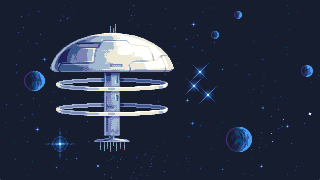

<p align="center">
  
</p>

<h1 align="center">TIMDA hub</h1>

<p align="center">
  <strong>A webring as objet d'art.</strong><br>
  A living, interactive art installation shaped like a space station.<br>
  Sites dock as "Sections" with a few DNS records and a signed request. No accounts, no JavaScript, everything opt-in.
</p>

<p align="center">
  <a href="https://timda.space">timda.space</a> ·
  <a href="https://timda.space/dock">Dock a Section</a> ·
  <a href="https://github.com/timda-space/timda.space">Specs, docs and CLI</a>
</p>

<p align="center">
  <a href="https://timda.space/random"></a>
  <a href="https://github.com/timda-space/timda-website/actions/workflows/test.yml"></a>
</p>

---

This is the code for the hub at `timda.space`: the main concourse of the station. **Technocratic Incorporated Multi-node Digital Astrodrome** (TIMDA) is a webring with the volume turned up: your site is a Section that docks to the station, visitors wander between Sections, and the more Sections there are, the more inhabited it feels. Concepts, specs and governance live in the separate [`timda.space`](https://github.com/timda-space/timda.space) repo.

**Want to dock a Section?** You don't need this repo. Read the [docking guide](https://github.com/timda-space/timda.space/blob/main/guides/docking.md) or go to [timda.space/dock](https://timda.space/dock). You publish a few DNS TXT records, then send a signed dock request.

Like the button above? Put it on your own site (host your own copy; `/dock` has the snippet).

**Contributing:** feedback, issues and PRs are welcome. Sections are anonymous; the project isn't, so contribute under your own account. See [`AGENTS.md`](AGENTS.md) for how the repo works and how to build and test.

## Layout

```
pages/             the source: edit these
  places.json      every place on the station: id, page slug, deck, full name
  _layout.html     the shared page shell
  arrivals.html    the front page (/) …
  hypermall.html   … and one file per place (/hypermall, /econopod, …), plus charter.html
map/
  station-map.mmd  station map source (Mermaid)
  station-map.svg  rendered map (generated)
hub/               the hub's logic: DNS lookups, TIMDA-2 signatures, registry, listings, Wormhole Post mail (+ tests)
workers/notify/    a tiny Worker that emails the operator about new dock requests
workers/prune/     a scheduled Worker that keeps only the newest deployments of the Pages project
functions/         Cloudflare Pages Functions: thin wrappers around hub/routes.mjs
public/            everything that gets deployed (the .html files are generated)
  style.css        styles; palette sampled from the station art
  _headers         security headers (CSP etc.), applied by Cloudflare
  favicon.svg
  art/station.png  320x180 station pixel art, shown unmodified (CC BY-NC-ND 4.0)
  fonts/           self-hosted Silkscreen, JetBrains Mono, Space Mono, Space Grotesk (SIL OFL)
tools/
  render-map.mjs      renders the map to map/station-map.svg
  build.mjs           builds public/*.html from pages/ (no dependencies)
  make-titled-art.py  builds an extended, lettered version into build/ (not for publication)
```

The site ships no JavaScript. Pages are plain HTML, generated ahead of time:

```console
$ node tools/build.mjs                                  # after editing pages/
$ node tools/render-map.mjs && node tools/build.mjs     # after editing map/ or places.json
```

The build also fingerprints the stylesheet (`/style.css?v=<hash>`), so a changed stylesheet always gets a new URL. Browsers, iOS ones especially, can otherwise pair fresh HTML with a stale cached `style.css`.

Every place has its own page at `/<slug>`. Every page carries the station directory as a drop-down (the map plus a list), with the current place marked "you are here": its box turns orange on the map, or for the Ivory Tower the whole spine.

[(top)](#readme)

## The hub (Pages Functions)

The site stays static and ships no JavaScript to browsers. A few routes run as Cloudflare Pages Functions, which is code at Cloudflare, not in the visitor's browser:

| Route | What it does |
| --- | --- |
| `POST /api/dock` | Takes a signed dock request (TIMDA-2) from the form on `/dock`, checks it against the Section's live DNS records, and adds the Section to the registry, where it waits for a Board resolution |
| `/hypermall` | The static page, with the storefronts filled in: approved Sections whose records are valid (open, closed, or pending and greyed out) |
| `/` | The static page, with "Sections docked" filled in |
| `/random`, `/next?from=<domain>` | Webring jumps: a redirect to an open Section's airlock |
| `POST /api/board` | Board resolutions (TIMDA-2 §5), signed with the hub's own key, from the form on `/executive-suites`: the agenda, approve, delist, reinstate |
| `/econopod` | The mast: `?domain=` runs the beacon test (a live check, like `timda finger`); `POST` runs the signal test on a signed statement |
| `POST /econopod/planner` | The record planner: a form in, every record out in several formats, checked (like `timda plan`) |
| `/lounge` | The Observation Lounge: a banner from an open Section; `?rotate` moves on every minute, `?hold=<domain>` keeps one |
| `/buttons/<domain>`, `/banners/<domain>` | A Section's checked 88x31 button or 468x60 banner, served by the hub, for approved Sections only |
| `POST /api/mail` | The Wormhole Post (TIMDA-3): takes signed `message`, `inbox` and `inbox-delete` statements from the form on `/econopod`; holds mail between listed Sections for 30 days (`mail:` keys) |
| `/feed` | The arrivals board as an Atom feed: approved Sections docking, changing status and leaving (also on `/`) |

The logic is in `hub/` (tested with `node --test hub/*.test.mjs tools/*.test.mjs`). `functions/` holds one-line wrappers. Records are re-checked whenever the hub lists or routes to a Section, and each result is reused for the shortest TTL among the records read (at least a minute, at most an hour). Checks are cached at Cloudflare's edge (the Cache API), not in KV, and pages read the registry from one index key (`registry`) rather than listing keys, so KV's free-plan daily limits (1,000 writes and 1,000 lists) are only touched by signed statements: docking, the Board and mail (each also stores its nonce). If you ever add a `section:` key by hand, delete the `registry` key too so it's rebuilt. The registry, nonces and check results live in a KV namespace bound as `REGISTRY`. Without that binding the pages fall back to static, and `/dock` says the registry isn't set up.

**Setup (once):**

1. Workers & Pages → **KV** → Create two namespaces: `timda-registry` (production) and `timda-registry-staging` (staging).
2. The `timda-station` Pages project → Settings → **Bindings** → Add → KV namespace. Variable name `REGISTRY`: namespace `timda-registry` for **production**, and `timda-registry-staging` for **preview**.
3. Redeploy. The next push does it.

`hub/timda1.mjs` is a copy of `tools/timda1.mjs` from the timda.space repo, and a test checks it hasn't drifted when both repos are checked out side by side.

[(top)](#readme)

## Pruning old deployments

Cloudflare keeps every Pages deployment live, with the code and bindings it was built with. A small scheduled Worker in `workers/prune/` (`timda-prune`, daily) keeps the newest 10 per environment (production and preview) and deletes the rest. It never deletes the project's current live deployment. It starts in dry-run mode, logging what it would delete.

**Setup (once):**

1. Dashboard → My Profile → API Tokens → Create Token → Custom, with one permission: **Account → Cloudflare Pages → Edit**, limited to your account.
2. `cd workers/prune && npx wrangler deploy`, then `npx wrangler secret put CF_API_TOKEN` and `npx wrangler secret put ACCOUNT_ID`.
3. Watch the first run with `npx wrangler tail` (or trigger it from the Worker's Settings → Triggers). When the "would delete" lines look right, set `DRY_RUN = "false"` in `wrangler.toml` and deploy again.

[(top)](#readme)

## Review notifications

When a new Section docks and waits for review, the hub emails the operator. Pages Functions can't send email, so a small separate Worker in `workers/notify/` does it, and the hub reaches it through a service binding named `NOTIFY`. The Worker has no public URL and writes to one address only, which must be a verified Email Routing destination. Those sends are free on every plan. Without the binding, nothing is sent, and the Board finds new Sections with a `board-agenda` resolution.

**Setup (once):**

1. Deploy the Worker, either way:
   - **Command line:** `cd workers/notify && npx wrangler deploy`, then `npx wrangler secret put TO` and enter your verified destination address.
   - **Dashboard:** Workers & Pages → Create → Worker named `timda-notify`, with `index.js` pasted in. Under Settings, add a **Send email** binding `EMAIL`, a variable `FROM` = `board@timda.space`, and a secret `TO` set to your address. Turn off the `workers.dev` and preview URLs.
2. The `timda-station` Pages project → Settings → **Bindings** → Add → Service binding. Variable name `NOTIFY`, service `timda-notify`, for **production and preview**. Staging's emails say which host they came from.
3. Redeploy.

[(top)](#readme)

## Launch button

`public/ring/timda-88x31.png` (and the 2x `timda-176x62.png`) is the 88x31 button Sections put on their sites; `/dock` explains how. It and `public/apple-touch-icon.png` are drawn from `favicon.svg` and Silkscreen, never from the station art, and every pixel is snapped to the palette. To redraw them:

```sh
node tools/render-badge.mjs
```

[(top)](#readme)

## Section buttons

A Section can publish `_button._timda.<domain>` (TIMDA-1 §6.1). `checkedSection` fetches it with the record check (no redirects, 16 KiB cap), keeps it only if `checkButtonImage` passes, and caches it with the check (at the edge, like the check itself). `/buttons/<domain>` (`functions/buttons/[domain].js`) serves that copy, and only for approved Sections. The HyperMall links to `/buttons/<domain>?v=<hash>`, never to the Section.

[(top)](#readme)

## The Observation Lounge

Open Sections that publish `_banner._timda.<domain>` (TIMDA-1 §6.2: a 468x60 PNG or GIF, optional `caption=`) are shown in `/lounge`, one at a time. The banner is fetched and checked with the record check, like the button, and served at `/banners/<domain>`. Each load shows a random one. `?rotate` opts in to an HTTP `Refresh: 60` header (only when there's more than one banner); it's off by default, since a page that reloads itself loses a screen reader's place (WCAG 2.2.2). `?hold=<domain>` holds one and stops the refresh.

[(top)](#readme)

## Station map

The map is written in Mermaid (`map/station-map.mmd`) but rendered offline, so the site still ships no JavaScript. `tools/render-map.mjs` draws it in a headless browser with the site's own fonts and CSS, strips Mermaid's styling, re-fits the boxes to the real text, and writes `map/station-map.svg`. `tools/build.mjs` then puts it in every page. `public/style.css` does all the skinning.

```console
$ npm --prefix tools install                          # once: Mermaid
$ npm --prefix tools install playwright && npx --prefix tools playwright install chromium   # once
```

Hover over a box (with a mouse), or tap or Tab to it, and a callout shows the place's full name. The callout links to that place's page. That's pure CSS (`:hover`, `:focus-within`). Map node ids match `pages/places.json`, which supplies the names and pages. The map is our own diagram of the station anatomy, not a tracing of the art.

[(top)](#readme)

## Run locally

```console
$ cd public && python3 -m http.server 8787
```

Then open <http://127.0.0.1:8787/>. Python's server needs the `.html` on inner pages (`/hypermall.html`); Cloudflare serves them at `/hypermall`. The `_headers` file only takes effect on Cloudflare.

[(top)](#readme)

## Infrastructure

The Cloudflare side (this site's Pages project, the staging domain, zone settings, and the hub's TIMDA-1 records) is managed with OpenTofu in the `timda.space` repo, under `infra/`.

[(top)](#readme)

## Deploy (Cloudflare Pages)

The `timda-station` Pages project (connected to this repo) serves `public/` (no build command; the pages are built and committed) and runs `functions/`. `public/_headers` sets the security headers on static files; `hub/routes.mjs` sets them on Function responses.

| Branch | Deploys to | KV bound as `REGISTRY` |
| --- | --- | --- |
| `main` | production: `timda.space` | `timda-registry` |
| `staging` | preview: `staging.timda.space` (a CNAME to `staging.timda-station.pages.dev`) | `timda-registry-staging` |

Preview builds are limited to `staging` (Settings → Builds → Branch control → Custom branches), so other branches don't get public preview URLs. Cloudflare builds a branch on the next push after it's allowed.

Every host but `timda.space` gets an amber **STAGING** (or **PREVIEW**) bar and `X-Robots-Tag: noindex`, added by `functions/_middleware.js`. The same files deploy to both branches, so it goes by hostname. `public/_routes.json` keeps CSS, fonts and images out of Functions.

Work goes to `staging` by pull request, is tried on staging.timda.space, and is released to `main` by a pull request from `staging`.

[(top)](#readme)

## Notes

- **Station art:** made with the [Space Station Generator](https://uselesspursuit.itch.io/space-station-generator) by uselesspursuit (credited in the footer). `art/station.png` was recovered from a screenshot of the generated art (3 screen pixels per art pixel, 320×180 canvas, near-duplicate colours merged). Re-export it from the generator at 1× (320×180) to replace it, then rebuild the titled version:

  ```console
  $ pip install pillow numpy fonttools brotli
  $ python3 tools/make-titled-art.py
  ```

- **Titled art:** `tools/make-titled-art.py` can extend the art to 320x200 with the name lettered in, but the art's licence (NoDerivatives) means that version can't be published without the generator authors' permission. It writes to `build/`, which isn't deployed.
- **No names:** the site carries no names or handles. Identity in TIMDA is a domain plus a public key.

[(top)](#readme)

## Licences

- **The hub** (code in `functions/`, `hub/`, `tools/`, `workers/`): [AGPL-3.0](LICENSE). Run your own hub, change it, share it; if you run a changed hub for others, share your changes too.
  - `hub/timda1.mjs` and `hub/sshsig.mjs` are copies of the timda.space repo's MIT-licensed reference code, so they can be reused under MIT.
- **The site's own words and pictures** (`pages/`, the TIMDA buttons and badge): [CC BY 4.0](LICENSE-content), with credit to timda.space.
- **Not ours, under their own terms:**
  - The station art, from the [Space Station Generator](https://uselesspursuit.itch.io/space-station-generator): [CC BY-NC-ND 4.0](https://creativecommons.org/licenses/by-nc-nd/4.0/).
  - The fonts: SIL Open Font License, with each font's licence in `public/fonts/`.

[(top)](#readme)
